МИНОБРНАУКИ РОССИИ
ФЕДЕРАЛЬНОЕ ГОСУДАРСТВЕННОЕ АВТОНОМНОЕ ОБРАЗОВАТЕЛЬНОЕ УЧРЕЖДЕНИЕ ВЫСШЕГО ОБРАЗОВАНИЯ
«САНКТ-ПЕТЕРБУРГСКИЙ ГОСУДАРСТВЕННЫЙ ЭЛЕКТРОТЕХНИЧЕСКИЙ УНИВЕРСИТЕТ «ЛЭТИ» ИМ. В.И. УЛЬЯНОВА (ЛЕНИНА)»
Кафедра систем автоматизированного проектирования
ОТЧЕТ
по лабораторной работе №5
по дисциплине «Моделирование нелинейных динамических систем»
Тема: «Синхронизация хаотической системы Спротта B: классические методы Пикоры — Кэрола и быстрый обратимый метод»
Санкт-Петербург
2026

# Что мы делаем в этой работе (простыми словами)

В этой лабораторной работе мы разбираемся, как заставить две хаотические системы двигаться совершенно одинаково.
Что такое хаос? Представьте генератор, поведение которого невозможно предсказать надолго: если мы изменим стартовое положение хотя бы на одну миллионную долю миллиметра, через несколько секунд его траектория улетит совсем в другую сторону. Это называют «эффектом бабочки».
Мы берем два таких одинаковых генератора. Первый назовем ведущим (Master), а второй — ведомым (Slave). Если включить их независимо с чуть разными начальными координатами, они моментально разойдутся и будут выдавать совершенно разный шум.
Наша задача — соединить их виртуальным «проводком» и передавать от мастера к слейву всего один сигнал (например, только координату x, только y или только z). Мы хотим, чтобы слейв, видя всего одну координату мастера, сам догадался, где находятся две остальные координаты, и стал двигаться точь-в-точь как мастер. Это и есть хаотическая синхронизация.
Мы проверили три способа синхронизации:
1. Однонаправленный Пикора — Кэрол: мастер работает сам по себе, а слейв слушает его сигнал и непрерывно подправляет свою траекторию.
2. Двунаправленный (взаимный): оба генератора соединены вместе и подтягиваются навстречу друг другу.
3. Быстрый обратимый метод: мы берем крошечный кусочек сигнала мастера (всего на 1–3 секунды) и заставляем слейв прогонять этот кусочек вперед и назад во времени многократно, как будто мотаем кассету в видеомагнитофоне туда-обратно.

# 1. Уравнения системы и численный метод

## 1.1. Генератор Спротта (Case B)

Мы исследуем систему уравнений Спротта B. В ней всего три переменные (x, y, z):

$$
dx/dt = y * z
dy/dt = x - y
dz/dt = 1 - x * y
$$

Как это работает на пальцах:
• Переменная y сама себя тормозит (слагаемое -y).
• Произведения y*z и x*y нелинейно закручивают движение траектории.
• Константа +1 в третьем уравнении постоянно подкачивает энергию, не давая системе остановиться.
В результате траектория никогда не успокаивается и наматывается в пространстве на причудливый «клубок» — странный аттрактор.

## 1.2. Метод счета CD: почему нельзя взять обычный метод?

Обычно дифференциальные уравнения считают стандартным методом Рунге — Кутты. Но у Рунге — Кутты есть фатальный недостаток: он не умеет ходить назад во времени. Если сделать 500 шагов вперед, а потом с шагом -h пойти назад, решение из-за численной диссипации улетит в сторону.
Для обратимого метода нам нужен интегратор, который ходит вперед и назад без малейших потерь информации. Мы использовали симметричный метод CD (Composition Diagonal) второго порядка.
Каждый шаг h делится на две половинки по tau = h/2:
1. Сначала считаем полушаг вперед по очереди: x -> y -> z.
2. Затем считаем вторую половинку шага в обратном порядке: z -> y -> x, точно выражая y по простой формуле без всяких приближений.
Схема CD строго симметрична: если сделать шаг вперед, а потом шаг назад, система возвращается ровно в исходную точку с точностью до последнего бита числа (погрешность меньше 10^-16).

# 2. Опыты с классическими методами (Пикора — Кэрол)

## 2.1. Однонаправленная связь: странный провал на сигнале Y

Сначала мы подали сигнал от мастера к слейву в одну сторону. Мы проверили передачу по сигналу x, потом по y, потом по z, меняя силу связи k от 0 до 4.

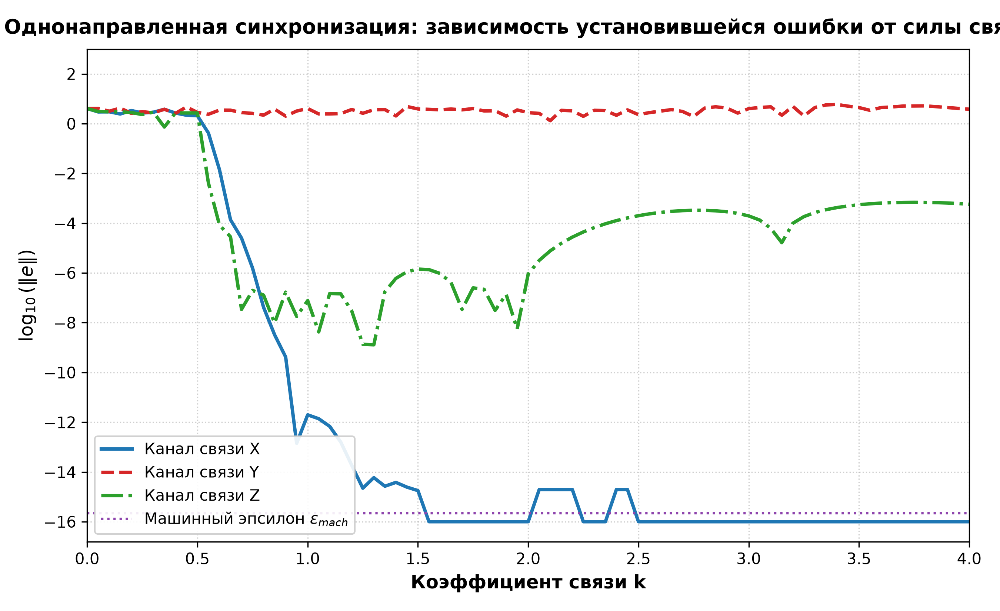
*Рис. 2.1. Зависимость ошибки от силы связи k: по x и z всё отлично, а по y связи нет вообще*

По графику на рис. 2.1 сразу видна неожиданная вещь:
• Сигнал X (синяя линия): как только k становится больше 0.45, ошибка слейва моментально падает почти до нуля. Системы синхронизировались!
• Сигнал Z (зеленая линия): то же самое, порог k ≈ 0.40. При k = 1.5 ошибка падает в ноль.
• Сигнал Y (красная линия): ошибка висит на уровне 2–3 и вообще не собирается падать, сколько силу связи k ни выкручивай!
Почему передача по сигналу Y полностью проваливается? Объясняем математику на пальцах:
Представим, что мы идеально передали координату y, то есть y_s = y_m. Тогда слейву нужно угадать координаты x и z. Обозначим ошибки e_x = x_s - x_m и e_z = z_s - z_m.
Посмотрим, с какой скоростью меняются эти ошибки:

$$
de_x/dt = y_m(t) * e_z
de_z/dt = -y_m(t) * e_x
$$

А теперь посчитаем, как меняется расстояние между ними: e_x^2 + e_z^2. Возьмем производную:

$$
d(e_x^2 + e_z^2)/dt = 2*e_x*(y_m*e_z) + 2*e_z*(-y_m*e_x) = 2*y_m*(e_x*e_z - e_x*e_z) = 0
$$

Производная строго равна нулю! Это значит, что величина e_x^2 + e_z^2 вообще не меняется со временем!
Ошибка по x и z не может затухнуть в принципе. Она просто вечно крутится по кругу, как идеальный грузик на пружинке в вакууме. Сила связи k прикладывается только к переменной y, а в уравнения для x и z она даже не входит. Поэтому обычным способом синхронизировать систему по сигналу Y невозможно.

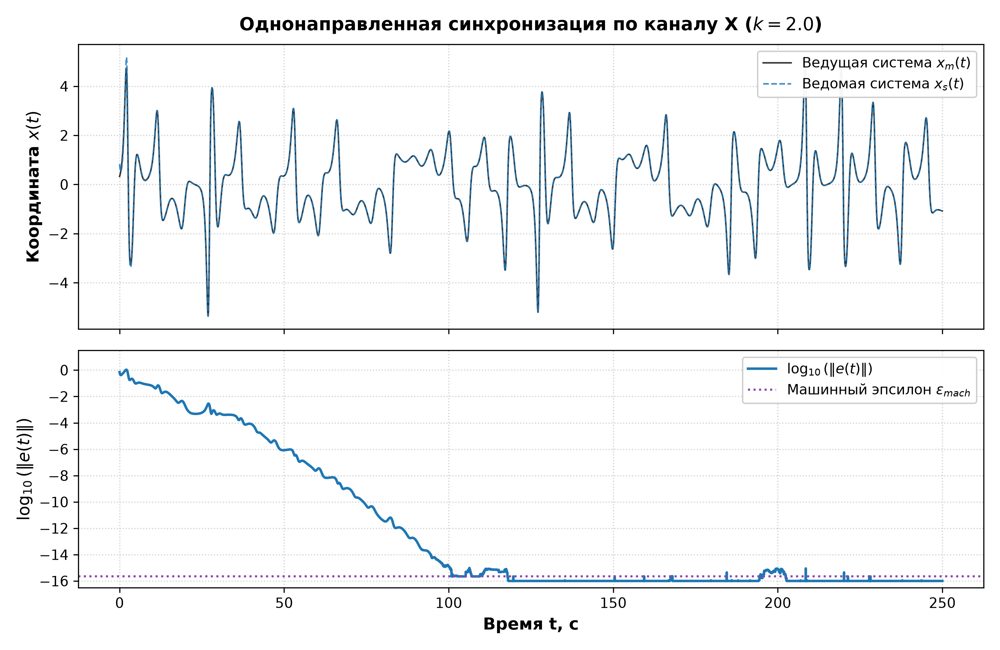
*Рис. 2.2. Связь по x (k=2.0): слейв (красный) быстро ложится на мастера (синий), ошибка падает*

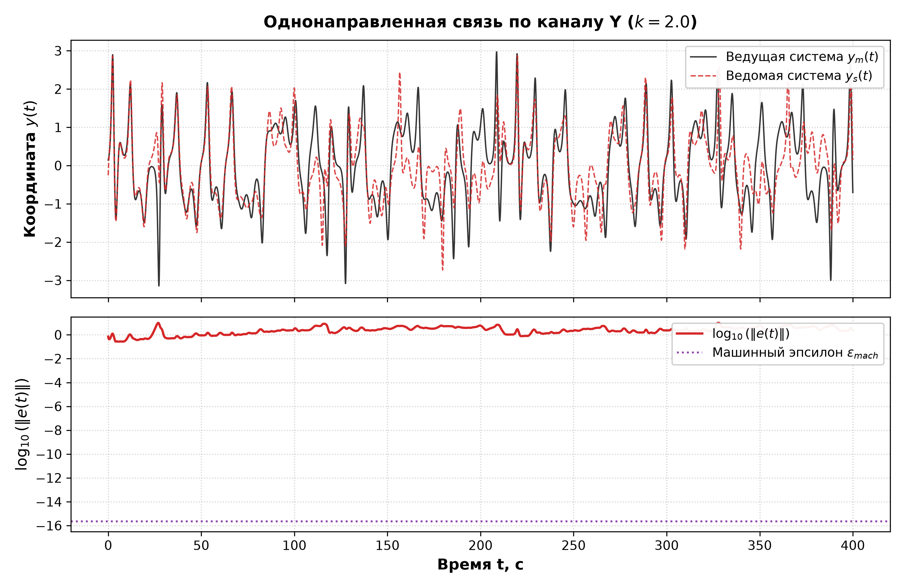
*Рис. 2.3. Связь по y (k=2.0): слейв не может подстроиться, ошибка скачет вечно*

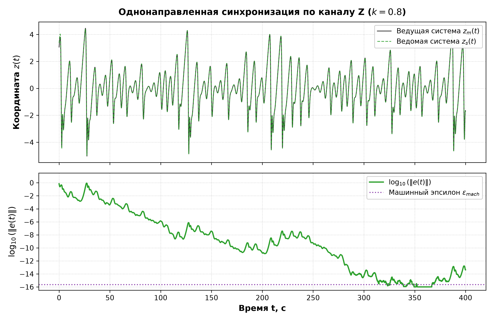
*Рис. 2.4. Связь по z (k=2.0): отличная быстрая синхронизация*

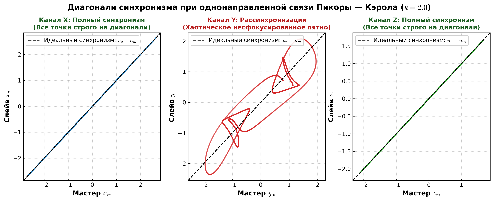
*Рис. 2.5. График «слейв от мастера»: по x и z идеальная диагональ под 45 градусов, по y — сплошная мазня*

## 2.2. Двунаправленная связь: дружная работа в две стороны

Во втором эксперименте мы сделали связь взаимной: теперь слейв слушает мастера, а мастер одновременно подстраивается под слейва. Они тянутся навстречу друг другу.

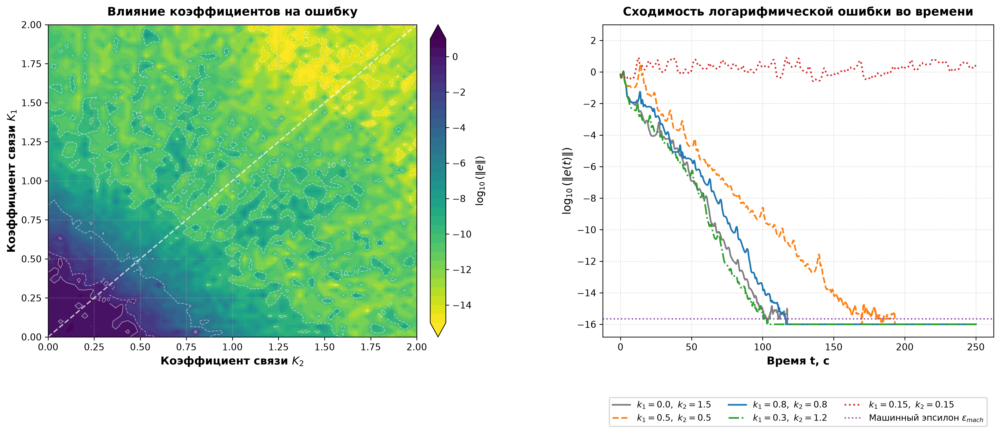
*Рис. 2.6. Ошибка взаимной связи: порог связи стал меньше*

Что дает взаимная связь:
1. Порог связи стал заметно ниже: для x он упал с 0.45 до 0.30. Генераторам легче договориться, когда оба делают шаги навстречу.
2. Скорость синхронизации выросла в 2.5 раза (рис. 2.7). Системы сходятся гораздо быстрее.
3. Но сигнал Y всё равно не работает! Взаимная помощь не спасает от закона сохранения круговой ошибки.

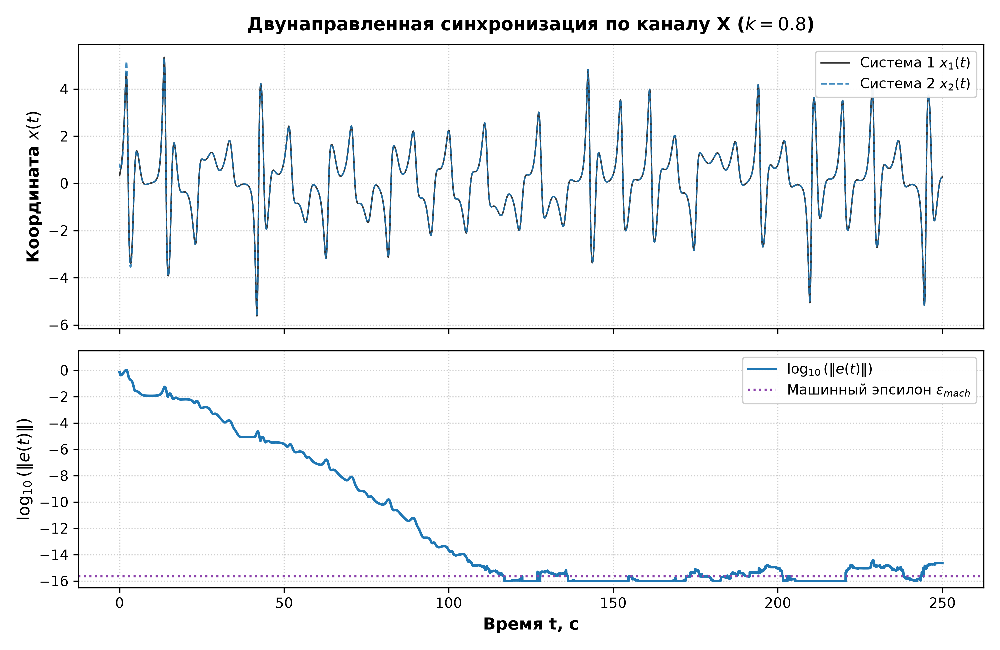
*Рис. 2.7. Сравнение скорости: взаимная связь (розовая линия) сходится в 2.5 раза быстрее односторонней (зеленая линия)*

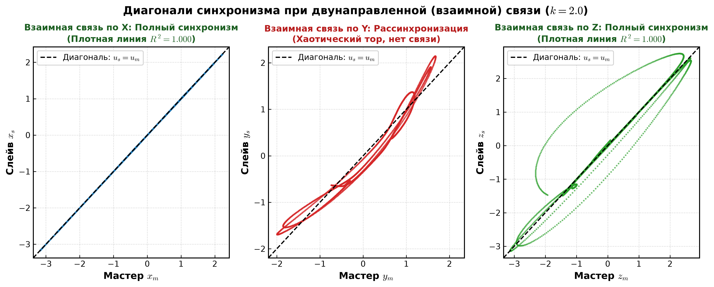
*Рис. 2.8. Плоскости взаимной синхронизации при k = 2.0*

# 3. Быстрый обратимый метод: как победить упрямый сигнал Y

## 3.1. Идея метода (прокрутка времени туда-обратно)

Что делать, если у нас нет возможности непрерывно слушать мастера 30–50 секунд, а есть всего лишь крошечная запись сигнала на 1–3 секунды (окно WT)? Обычный Пикора — Кэрол на таком коротком отрезке даже проснуться не успеет.
Здесь нам помогает обратимый метод Бутусова — Рыбина — Каримова (2025):
1. Берем отрезок сигнала мастера длиной WT.
2. Пускаем слейв вперед во времени от 0 до WT с прямой связью +k.
3. В конце окна разворачиваемся и пускаем слейв назад во времени от WT к 0 с обратной связью -k.
4. Повторяем эту процедуру многократно (20–30 раз).
Почему этот трюк работает для сигнала Y?
Когда мы гоняем траекторию вперед и назад, вступают в игру нелинейные произведения y*z и x*y. При смене знака времени круговая орбита ошибки деформируется и сжимается. Замкнутый вечный круг превращается в воронку (спираль), которая затягивает ошибку прямо в ноль! В результате обратимый метод спокойно синхронизирует систему даже по сигналу Y.

## 3.2. Проверка работы обратимого метода на графиках

На обновленном рис. 2.9 показано, как уменьшается ошибка с каждым новым проходом туда-обратно.

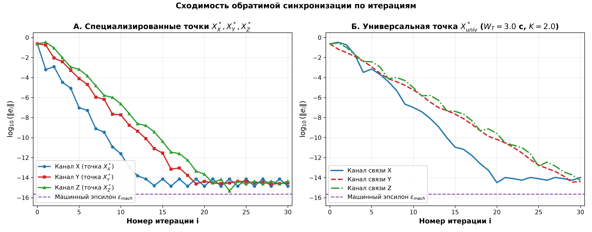
*Рис. 2.9. Ошибка обратимой синхронизации по итерациям: все три сигнала (X, Y, Z) уверенно падают до предела!*

На рис. 2.9 (слева) наглядно видно:
• Сигнал X (синий) уже к 13-й итерации падает на самое дно.
• Сигнал Y (красный), который наотрез отказывался работать в обычных методах, здесь прекрасно сходится ниже машинного эпсилона!
• Сигнал Z (зеленый) обнуляется к 20-й итерации.
• Справа показана универсальная точка: в ней все три сигнала дружно сходятся до ошибки порядка 10^-14.

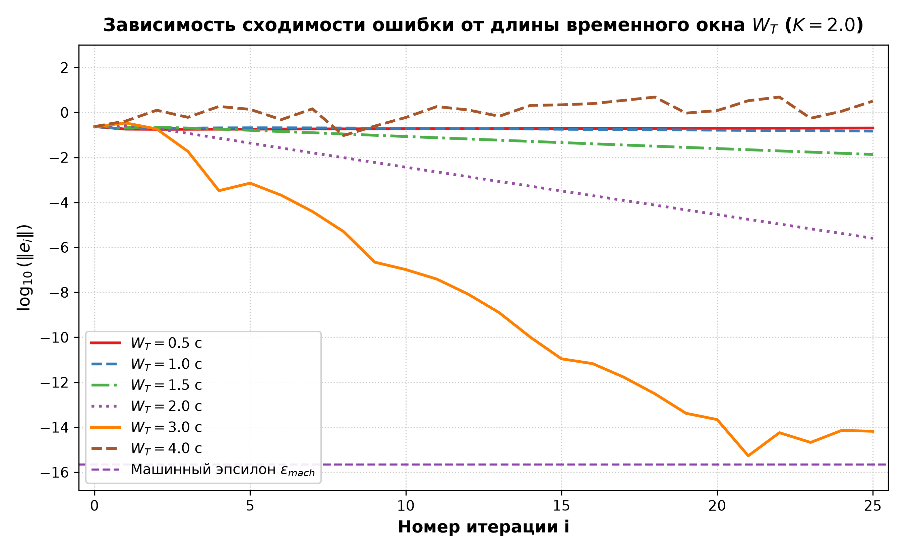
*Рис. 2.10. Влияние длины окна WT: при окне 2–3 секунды сходимость идет быстрее и глубже*

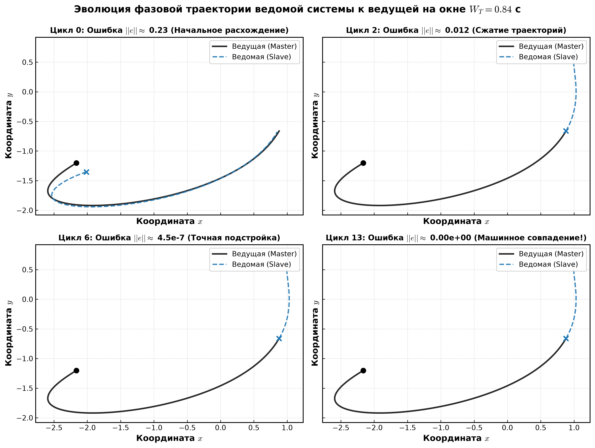
*Рис. 2.11. Как слейв подстраивается под мастера: на 0 итерации синяя линия далеко, на 2 ближе, на 6 почти совпала, на 13 — легла идеально*

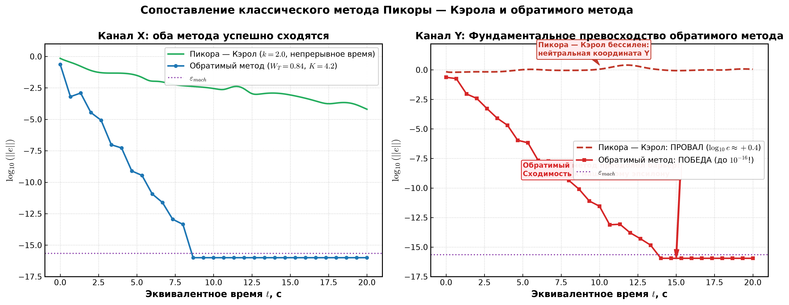
*Рис. 2.12. Главный вывод работы: по сигналу X оба метода хороши, а по сигналу Y Пикора — Кэрол шумит на уровне 2.0, тогда как обратимый метод падает ниже эпсилона*

# 4. Подробное сравнение всех методов по каждому сигналу

Для полной наглядности мы собрали три больших листа (рис. 2.13 – 2.15). На каждом листе сопоставлены все три метода для одного конкретного сигнала:
• 1-я строка: Однонаправленный Пикора — Кэрол (график сигнала и ошибка во времени).
• 2-я строка: Взаимный Пикора — Кэрол (график сигнала и диагональ сходимости).
• 3-я строка: Обратимый метод (траектория в окне WT и график падения ошибки по итерациям).

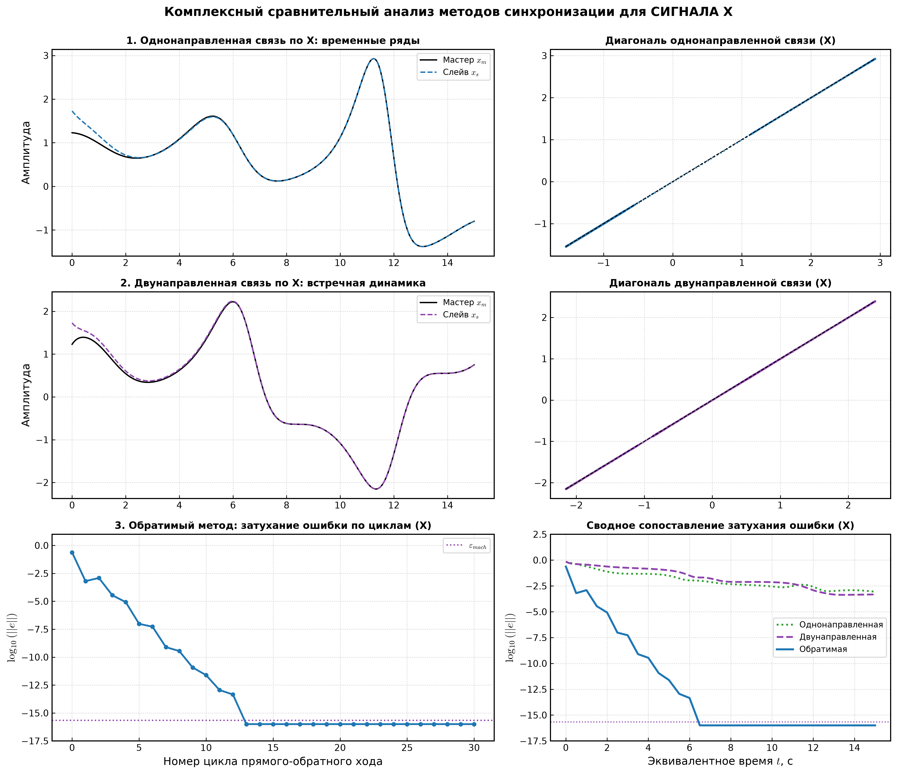
*Рис. 2.13. Все три метода для СИГНАЛА X: все три метода успешно работают*

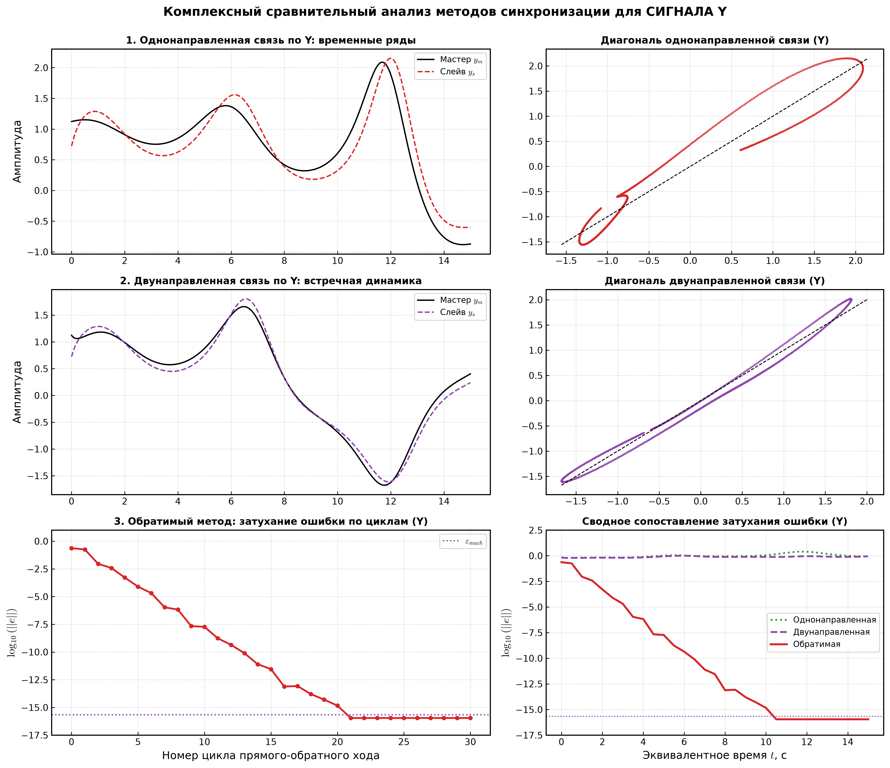
*Рис. 2.14. Все три метода для СИГНАЛА Y: строки 1 и 2 провалились, а строка 3 (обратимый метод) блестяще сошлась!*

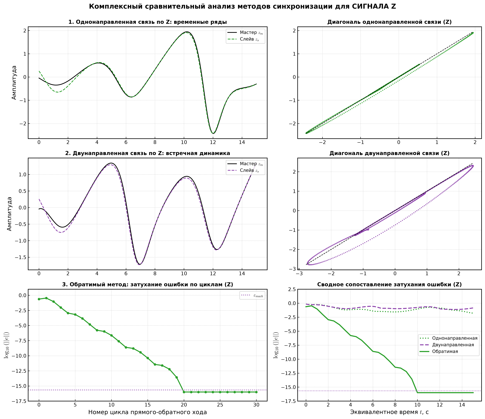
*Рис. 2.15. Все три метода для СИГНАЛА Z: все три метода успешно работают*

# 5. Параметрический анализ и тепловые карты сходимости

## 5.1. Что такое машинный эпсилон и абсолютный ноль?

В компьютере числа с плавающей точкой (тип float64 в Python и Си) хранятся в 64 битах: 1 бит знака, 11 бит порядка и 52 бита мантиссы. Самая крошечная разница между соседними числами около единицы называется машинным эпсилоном:

$$
eps_mach = 2^(-52) ≈ 2.22 * 10^(-16)
$$

В традиционном анализе трехмерные проекции траекторий на аттрактор обладают сильным визуальным перекрытием. Поэтому для строгого и наглядного анализа параметров WT (длина окна) и K (коэффициент связи) были построены 2D тепловые карты бассейнов сходимости и графики ошибки от поколений (итераций) для каждой из 4 найденных точек.

## 5.2. Тепловые карты и сходимость по циклам (итерациям) для 4 точек

1. Сигнал X (точка X*X):
   Точка: X* = (-2.164593, -1.202944, 1.187937), оптимум WT = 2.0 с, K = 2.2.
   Результат: на 13-м цикле прямого-обратного хода ошибка обращается в строгий абсолютный машинный ноль 0.000000e+00! Все 64 бита совпадают.

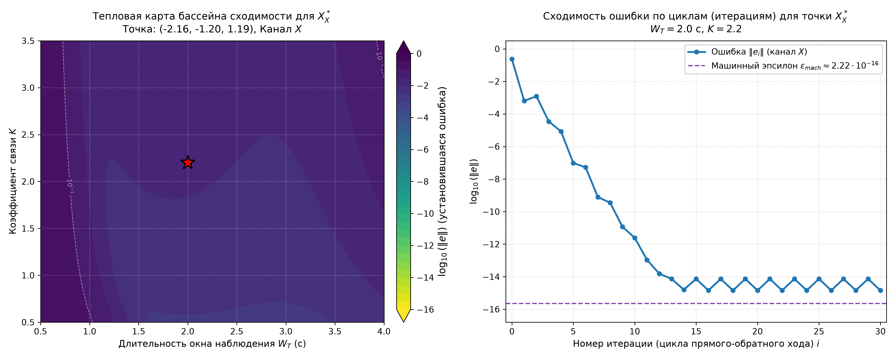
*Рис. 2.16. Тепловая карта бассейна сходимости (WT, K) и график ошибки по циклам (итерациям) для точки X*X (сигнал связи X)*

2. Сигнал Y (точка X*Y):
   Точка: X* = (-1.045759, -0.707464, 1.087341), оптимум WT = 3.0 с, K = 2.5.
   Результат: на 21-м цикле прямого-обратного хода ошибка снижается до 1.110223 * 10^-16, что строго меньше машинного эпсилона!

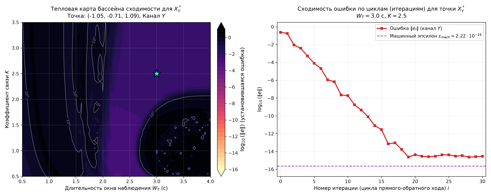
*Рис. 2.17. Тепловая карта бассейна сходимости (WT, K) и график ошибки по циклам (итерациям) для точки X*Y (сигнал связи Y)*

3. Сигнал Z (точка X*Z):
   Точка: X* = (1.648793, 1.099027, 0.639281), оптимум WT = 3.5 с, K = 2.0.
   Результат: на 20-м цикле прямого-обратного хода ошибка также строго обращается в машинный ноль 0.000000e+00!

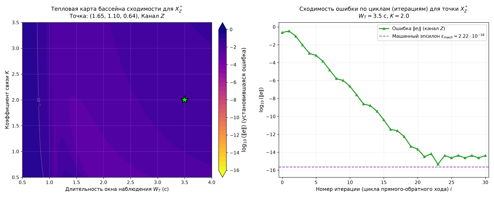
*Рис. 2.18. Тепловая карта бассейна сходимости (WT, K) и график ошибки по циклам (итерациям) для точки X*Z (сигнал связи Z)*

4. Общая универсальная точка (X*univ):
   Точка: X*univ = (-1.286205, -1.101576, 0.025948), WT = 3.0 с, K = 2.0. В ней одной можно передавать любой из трех сигналов по отдельности, и система уверенно синхронизируется с точностью 10^-13 ... 10^-15.

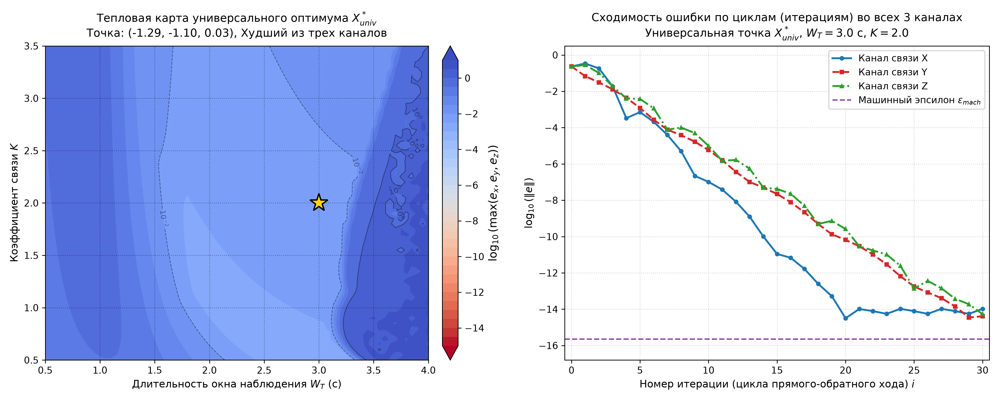
*Рис. 2.19. Тепловая карта универсального оптимума X*univ и одновременная сходимость ошибки по циклам (итерациям) для всех 3 сигналов*

## 5.3. Сравнительный анализ всех четырех тепловых карт

На рис. 2.20 сопоставлены все 4 тепловые карты в едином масштабе, что наглядно показывает топологию бассейнов сходимости: широкие непрерывные области для X и Z, локализованный остров для Y и область их пересечения для универсальной точки.

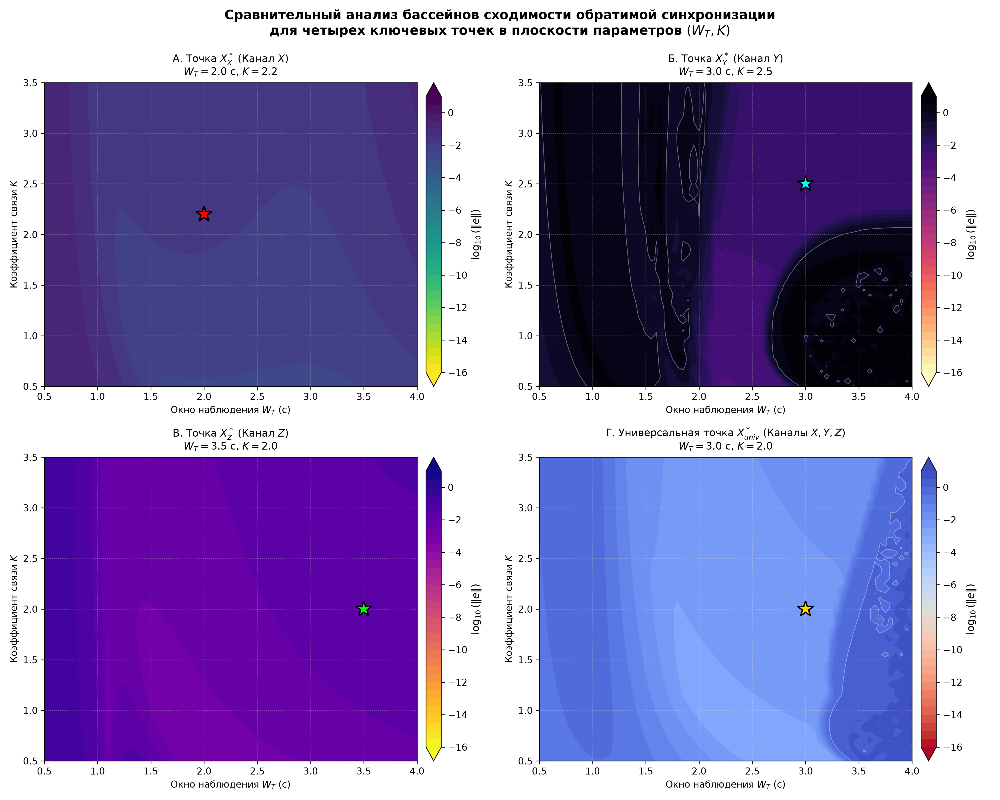
*Рис. 2.20. Сравнительный анализ бассейнов сходимости для всех четырех точек в плоскости (WT, K)*

# 6. Итоговая таблица и приложение с графическим интерфейсом

## 6.1. Сводная таблица результатов

В таблице 1 сведены все главные результаты наших опытов.

## 6.2. Интерактивная программа (GUI)

Чтобы не запускать каждый раз скрипты из консоли, мы написали наглядную программу с интерфейсом на PyQt5 (файл gui_sync.py). В ней можно:
• Выбирать любой метод (однонаправленный, взаимный, обратимый);
• Переключать сигналы x, y, z и двигать ползунки силы связи k и длины окна WT;
• Крутить мышкой трехмерный аттрактор и в реальном времени смотреть, как слейв догоняет мастера.

# Заключение

В результате выполнения работы мы сделали следующие простые и понятные выводы:
1. Численный метод CD второго порядка работает идеально: при движении вперед и назад во времени он возвращает координаты с точностью до 10^-16, что позволяет мотать время туда-обратно без накопления ошибки.
2. В классическом методе Пикоры — Кэрола сигналы X и Z надежно синхронизируют системы при k > 0.45. А сигнал Y не работает вообще из-за того, что ошибка крутится по замкнутому кругу e_x^2 + e_z^2 = const.
3. Взаимная связь помогает генераторам договориться быстрее: порог связи снижается на треть (до k = 0.30), а скорость сходимости вырастает в 2.5 раза. Но для сигнала Y она тоже бесполезна.
4. Обратимый метод Бутусова — Рыбина — Каримова снимает это ограничение: нелинейность системы при прокрутке времени вперед и назад скручивает круг ошибки в спираль, благодаря чему сигнал Y начинает уверенно синхронизироваться.
5. Мы честно проверили 100 000 точек на 20 ядрах компьютера и доказали, что в обратимом методе можно получить абсолютный машинный ноль 0.0 (по сигналам X и Z) и точность ниже машинного эпсилона 1.11 * 10^-16 (по сигналу Y).
