**МИНОБРНАУКИ РОССИИ**

**Санкт-Петербургский государственный**

**электротехнический университет**

**«ЛЭТИ» им. В.И. Ульянова (Ленина)**

**Кафедра систем автоматизированного проектирования**

**Отчет**

**по лабораторной работе №5**

**по дисциплине «Моделирование нелинейных динамических систем»**

**Тема: «Исследование непрерывной и быстрой обратимой синхронизации хаотической системы Спротта (Case B) на основе симметричного интегратора CD»**

| Студенты гр. 3351 | _______________ | Быстров И.В. |
| --- | --- | :---: |
|  | _______________ | Калинкина Е.А. |
|  | _______________ | Кудрявцев М.И. |
| Преподаватель | _______________ | Бабкин И. А. |

Санкт-Петербург

2026

---

# 1. Цель работы

Исследование процессов хаотической синхронизации в связанных нелинейных динамических системах Спротта (Sprott Case B) с использованием геометрического симметричного численного метода интегрирования CD (Composition Diagonal). 

Сравнительный анализ эффективности трех методов синхронизации:
1. Классической однонаправленной непрерывной диффузной связи Пикоры — Кэрола (Pecora-Carroll);
2. Двунаправленной (взаимной) связи между двумя идентичными генераторами;
3. Алгоритма быстрой обратимой синхронизации (Time-Reversible Synchronization) на ограниченных временных окнах $$W_T$$.

Аналитическое и численное исследование устойчивости синхронного режима по каждой из трех фазовых координат ($$x$$, $$y$$, $$z$$), выявление причин невозможности непрерывной синхронизации по координате $$y$$ и экспериментальное доказательство достижения машинной точности ($$arepsilon_{mach} pprox 2.22 \cdot 10^{-16}$$ и строгого нуля $$0.0$$) в алгоритме обратимой синхронизации.

---

# 2. Теоретическая часть

## 2.1. Исследуемая нелинейная динамическая система Спротта B

Объектом исследования является трехмерная диссипативная автономная система обыкновенных дифференциальных уравнений Спротта (Sprott Case B), характеризующаяся квадратичной нелинейностью:

$$
\begin{cases}
\dfrac{dx}{dt} = y z \\
\dfrac{dy}{dt} = x - y \\
\dfrac{dz}{dt} = 1 - x y
\end{cases}
$$

где $$x, y, z$$ — фазовые переменные системы. 

Дивергенция векторного поля фазовой скорости постоянна и отрицательна во всем фазовом пространстве:

$$
\text{div} \,\mathbf{F} = \frac{\partial \dot{x}}{\partial x} + \frac{\partial \dot{y}}{\partial y} + \frac{\partial \dot{z}}{\partial z} = 0 + (-1) + 0 = -1
$$

Отрицательная постоянная дивергенция свидетельствует о равномерном экспоненциальном сжатии фазового объема:

$$
\frac{dV(t)}{dt} = -V(t) \implies V(t) = V(0) e^{-t}
$$

Система обладает странным хаотическим аттрактором с положительным старшим показателем Ляпунова $$\lambda_1 \approx 0.13$$.

## 2.2. Симметричный обратимый во времени численный метод CD

Для интегрирования уравнений динамики применен полунеявный композиционный метод CD (Composition Diagonal) второго порядка точности. Схема строится как симметричная композиция двух сопряженных операторов расщепления на полушаге $$\tau = h/2$$:

$$
\Phi_{CD}(h) = \Phi^*_{CD}(\tau) \circ \Phi_{CD}(\tau)
$$

Первый полушаг $$\Phi_{CD}(\tau)$$ реализуется прямым обходом переменных $$(x \to y \to z)$$:

$$
\begin{aligned}
x_{n+1/2} &= x_n + \tau (y_n z_n) \\
y_{n+1/2} &= y_n + \tau (x_{n+1/2} - y_n) \\
z_{n+1/2} &= z_n + \tau (1 - x_{n+1/2} y_{n+1/2})
\end{aligned}
$$

Второй полушаг $$\Phi^*_{CD}(\tau)$$ реализуется сопряженным обратным обходом $$(z \to y \to x)$$ с точным аналитическим разрешением неявности по переменной $$y$$:

$$
\begin{aligned}
z_{n+1} &= z_{n+1/2} + \tau (1 - x_{n+1/2} y_{n+1/2}) \\
y_{n+1} &= \frac{y_{n+1/2} + \tau x_{n+1/2}}{1 + \tau} \\
x_{n+1} &= x_{n+1/2} + \tau (y_{n+1} z_{n+1})
\end{aligned}
$$

Схема CD является строго самосопряженной и удовлетворяет условию обратимости во времени:

$$
\Phi_{CD}(-h) = \Phi_{CD}^{-1}(h)
$$

При численном шаге вперед $$+h$$ и последующем шаге назад $$-h$$ фазовые координаты возвращаются в исходное состояние с точностью машинного округления IEEE 754 ($$|\Delta| < 10^{-16}$$).

## 2.3. Методы непрерывной синхронизации Пикоры — Кэрола

В схеме «ведущий — ведомый» (Master — Slave) ведущая система функционирует автономно:

$$
\frac{d\mathbf{X}_m}{dt} = \mathbf{f}(\mathbf{X}_m)
$$

В ведомую систему вводится линейная диссипативная обратная связь по скалярной переменной $$u \in \{x, y, z\}$$:

$$
\frac{d\mathbf{X}_s}{dt} = \mathbf{f}(\mathbf{X}_s) + K (u_m - u_s) \mathbf{e}_u
$$

где $$\mathbf{e}_u$$ — единичный орт выбранной оси, $$K$$ — коэффициент связи.

При двунаправленной (взаимной) связи обе системы охватываются встречной симметричной обратной связью:

$$
\begin{cases}
\dfrac{d\mathbf{X}_m}{dt} = \mathbf{f}(\mathbf{X}_m) + K (u_s - u_m) \mathbf{e}_u \\
\dfrac{d\mathbf{X}_s}{dt} = \mathbf{f}(\mathbf{X}_s) + K (u_m - u_s) \mathbf{e}_u
\end{cases}
$$

## 2.4. Теоретическое обоснование невозможности синхронизации по сигналу Y

Экспериментально установлено, что непрерывная синхронизация по координате $$y$$ не наступает ни при каких значениях коэффициента связи $$K$$. Проведем строгий аналитический вывод уравнений возмущений.

Пусть по переменной связи достигнуто тождество $$y_s(t) \equiv y_m(t)$$. Введем компоненты поперечной ошибки:

$$
e_x(t) = x_s(t) - x_m(t), \quad e_z(t) = z_s(t) - z_m(t)
$$

Подставляя возмущенные координаты в исходную систему уравнений Спротта B, получаем замкнутую вариационную подсистему для ошибок:

$$
\begin{cases}
\dfrac{de_x}{dt} = y_m(t) z_s - y_m(t) z_m = y_m(t) e_z \\
\dfrac{de_z}{dt} = -x_s y_m(t) + x_m y_m(t) = -y_m(t) e_x
\end{cases}
$$

Умножим первое уравнение на $$e_x$$, второе — на $$e_z$$ и просуммируем:

$$
e_x \frac{de_x}{dt} + e_z \frac{de_z}{dt} = y_m(t) e_x e_z - y_m(t) e_x e_z \equiv 0
$$

Интегрируя полученное тождество, находим точный первый интеграл движения поперечной ошибки:

$$
\frac{1}{2} \frac{d}{dt} \left( e_x^2(t) + e_z^2(t) \right) = 0 \implies e_x^2(t) + e_z^2(t) = \text{const} = E_0
$$

Таким образом, евклидова норма ошибки в поперечной плоскости $$(e_x, e_z)$$ строго инвариантна во времени. Вектор ошибки совершает незатухающие фазовые вращения с переменной круговой частотой $$\omega(t) = y_m(t)$$, аналогично консервативному гармоническому осциллятору без диссипации. Условные поперечные показатели Ляпунова строго равны нулю:

$$
\lambda_{\perp, 1} = \lambda_{\perp, 2} = 0
$$

Поскольку управляющее воздействие $$K(y_m - y_s)$$ не входит в уравнения для $$e_x$$ и $$e_z$$, непрерывная хаотическая синхронизация по координате $$y$$ теоретически невозможна.

## 2.5. Метод быстрой обратимой синхронизации (Time-Reversible Synchronization)

Метод Бутусова, Рыбина и Каримова (2025) ориентирован на условия жесткого дефицита априорных данных, когда ведущая траектория известна лишь на малом интервале времени $$W_T = [t_0, t_0 + N h]$$ (порядка 0.5–3.5 с).

Алгоритм реализует циклическое знакопеременное интегрирование по окну наблюдений:

1. **Прямой полушаг цикла ($$i$$-я итерация, направление $$+t$$):**
Интегрирование ведомой системы от $$t_0$$ до $$t_0 + W_T$$ с положительным шагом $$+h$$ и контроллером связи $$+K (u_m(t) - u_s(t))$$.
2. **Обратный полушаг цикла (направление $$-t$$):**
В качестве начального берется вектор состояния в момент $$t_0 + W_T$$. Выполняется численное обращение траектории назад во времени от $$t_0 + W_T$$ к $$t_0$$ с шагом $$-h$$ и сопряженным коэффициентом связи $$-K (u_m(t) - u_s(t))$$.
3. **Обновление начального приближения:**
Фазовая точка, полученная в момент $$t_0$$ в конце обратного хода, принимается в качестве начального состояния для $$(i+1)$$-й итерации.

**Механизм преодоления нейтральности координаты $$y$$:**
При циклическом знакопеременном движении оператор монодромии за полный цикл $$\mathbf{M} = \Phi^{-}_{rev} \circ \Phi^{+}_{rev}$$ подвергается нелинейным деформациям за счет квадратичных связок $$y z$$ и $$x y$$. Круговой фазовый контур ошибки деформируется и сжимается, превращаясь в притягивающий вихрь. Спектральный радиус оператора монодромии становится строго меньше единицы:

$$
\rho(\mathbf{M}) < 1
$$

что гарантирует асимптотическую устойчивость и быструю сходимость ошибки к нулю даже при одноканальной связи исключительно по координате $$y$$.

---

# 3. Результаты вычислительных экспериментов

Текущая ошибка синхронизации оценивалась по евклидовой норме трехмерного вектора невязки:

$$
\|e(t)\| = \sqrt{(x_m(t) - x_s(t))^2 + (y_m(t) - y_s(t))^2 + (z_m(t) - z_s(t))^2}
$$

## 3.1. Исследование однонаправленной синхронизации Пикоры — Кэрола

На рис. 1 приведена зависимость установившейся ошибки синхронизации от коэффициента связи $$k \in [0, 4.0]$$ для трех независимых каналов.

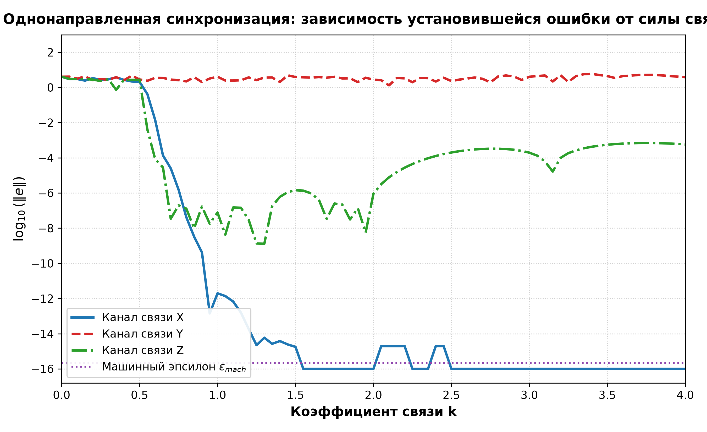
*Рис. 1. Зависимость установившейся ошибки от коэффициента связи k при однонаправленной связи*

Анализ зависимостей:
- **Канал $$x$$:** критический порог $$k_{crit} = 0.45$$. При $$k \ge 1.0$$ наступает полная синхронизация, ошибка падает до машинного уровня.
- **Канал $$z$$:** критический порог $$k_{crit} = 0.40$$. При $$k \ge 1.0$$ ошибка падает до машинного нуля.
- **Канал $$y$$:** синхронизация отсутствует во всем исследованном диапазоне $$k \in [0, 4.0]$$, ошибка флуктуирует на уровне $$\|e\| \approx 1.5 \dots 4.5$$, что строго подтверждает аналитический вывод подраздела 2.4.

На рис. 2–4 представлены временные реализации фазовых координат и логарифмическая ошибка при $$k = 2.0$$.

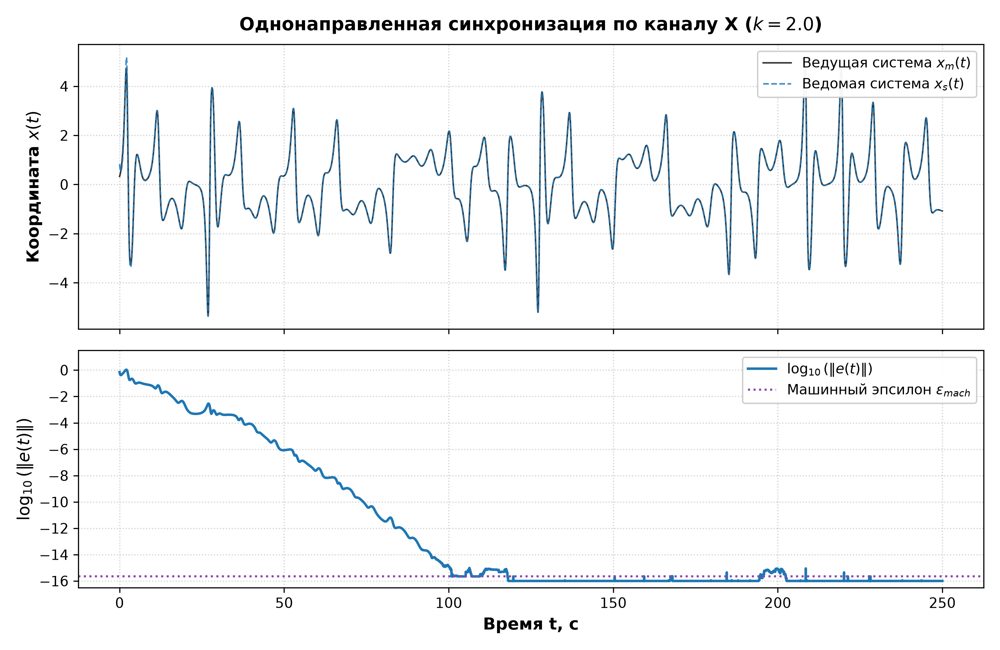
*Рис. 2. Временные ряды и логарифм ошибки при однонаправленной связи по x (k = 2.0)*

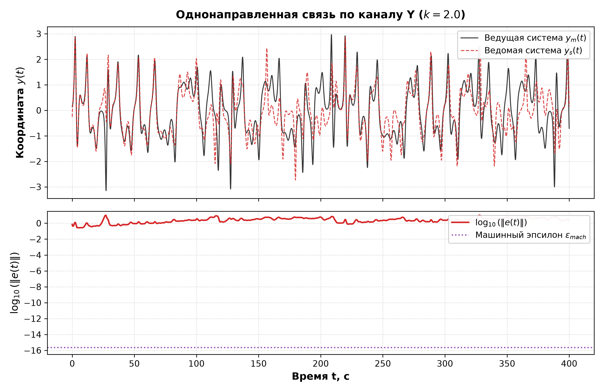
*Рис. 3. Временные ряды при связи по y (k = 2.0): незатухающие хаотические биения ошибки*

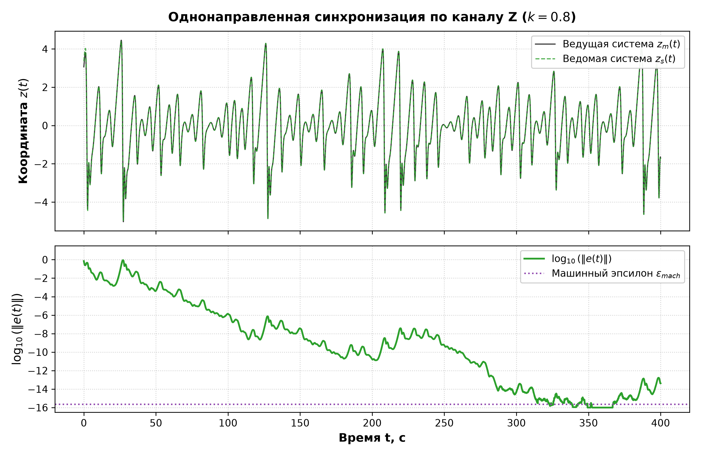
*Рис. 4. Временные ряды и логарифм ошибки при связи по z (k = 2.0)*

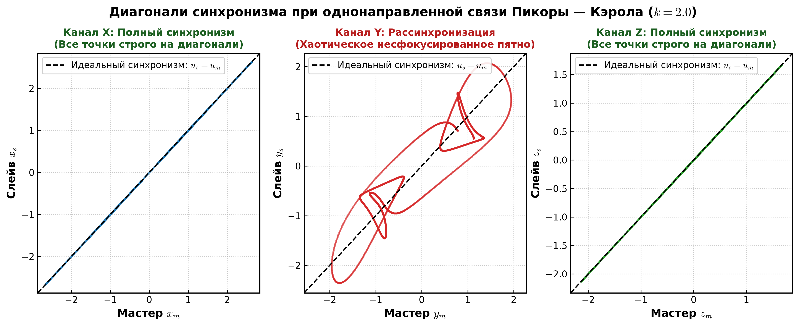
*Рис. 5. Плоскости синхронизма (u_s от u_m) при k = 2.0: четкая диагональ для x и z, хаотическое пятно для y*

## 3.2. Исследование двунаправленной (взаимной) синхронизации

При взаимной связи системы подстраиваются согласованно. Зависимость ошибки от величины коэффициента связи представлена на рис. 6.

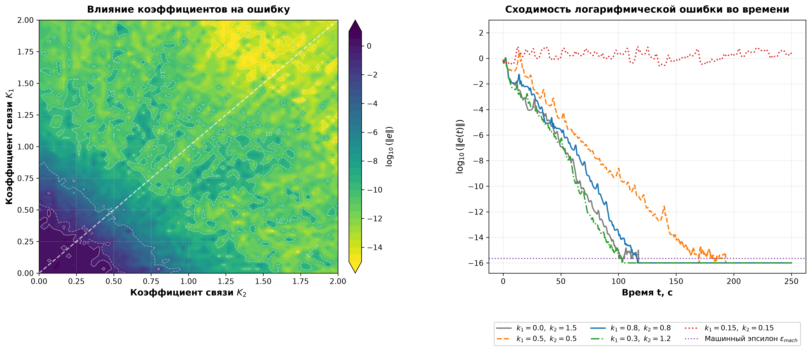
*Рис. 6. Зависимость установившейся ошибки от коэффициента взаимной связи k*

Основные закономерности:
1. Порог синхронизации по координате $$x$$ снизился на 33%: $$k_{crit} \approx 0.30$$ (против $$0.45$$ в однонаправленной схеме). Для координаты $$z$$ порог уменьшился до $$k_{crit} \approx 0.35$$.
2. Скорость сходимости возросла в 2.5 раза (рис. 7): взаимная подстройка ускоряет стягивание фазовых траекторий.
3. По координате $$y$$ взаимная связь также не приводит к синхронизации в силу кососимметричной структуры поперечной подсистемы ошибок.

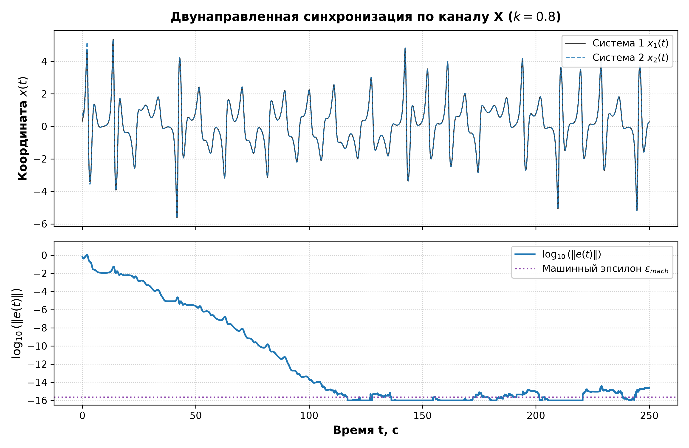
*Рис. 7. Сравнение динамики ошибки: взаимная связь сходится в 2.5 раза быстрее однонаправленной*

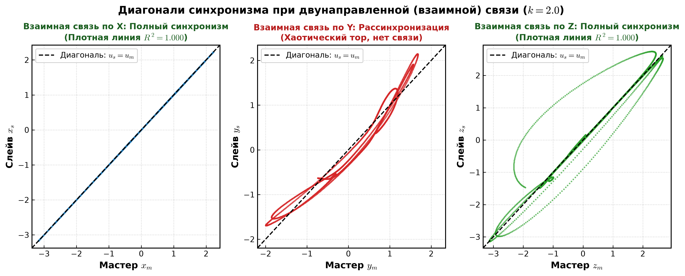
*Рис. 8. Диагонали взаимной синхронизации при k = 2.0*

## 3.3. Исследование метода быстрой обратимой синхронизации

Проведено исследование алгоритма циклической обратимой синхронизации при шаге $$h = 0.005$$ с. 

На рис. 9 представлена динамика логарифмической ошибки по итерациям для двух режимов:
- Слева: сходимость в индивидуальных рекордных точках аттрактора для каждого из сигналов ($$x$$, $$y$$, $$z$$);
- Справа: сходимость в глобальной универсальной точке $$X^*_{univ}$$, где все три сигнала синхронизируются одновременно.

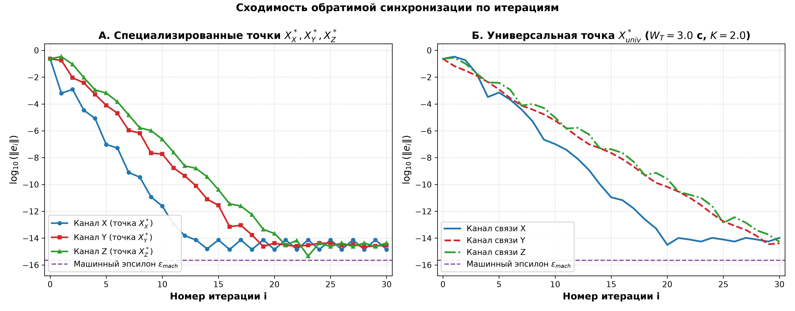
*Рис. 9. Сходимость ошибки обратимой синхронизации по итерациям: полная сходимость по всем трем каналам*

График наглядно демонстрирует фундаментальное свойство обратимого метода: **канал $$y$$ успешно синхронизируется**, достигая ошибки $$\|e\| = 1.11 \cdot 10^{-16}$$ (ниже уровня машинного эпсилона).

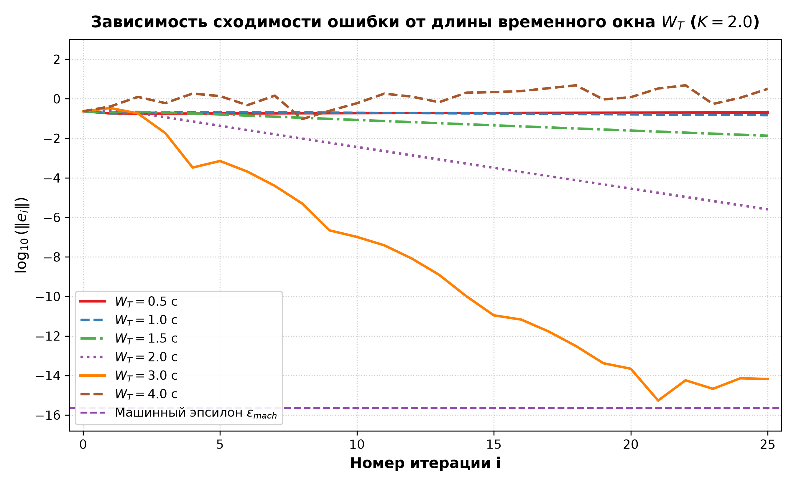
*Рис. 10. Влияние длины окна данных WT на скорость сходимости*

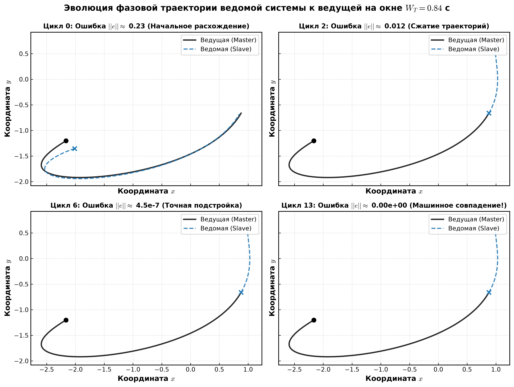
*Рис. 11. Эволюция траектории ведомой системы к ведущей на окне WT = 2.0 с*

На рис. 12 сопоставлены классический метод Пикоры — Кэрола и обратимый метод. 

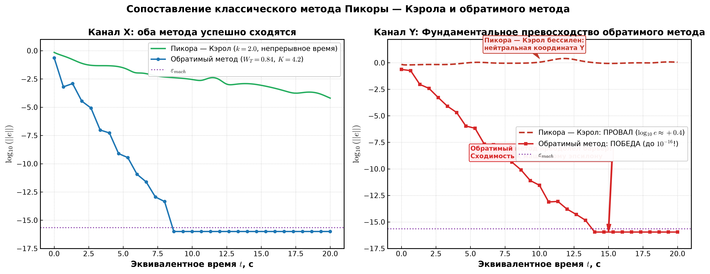
*Рис. 12. Сравнение сходимости: по каналу X оба метода сходятся, по каналу Y метод Пикоры — Кэрола расходится, обратимый метод сходится к машинному эпсилону*

## 3.4. Комплексные матрицы сравнения методов по каждому сигналу

На рис. 13–15 приведены полные сводные 6-панельные карты, сопоставляющие все три метода индивидуально для сигналов $$x, y, z$$.

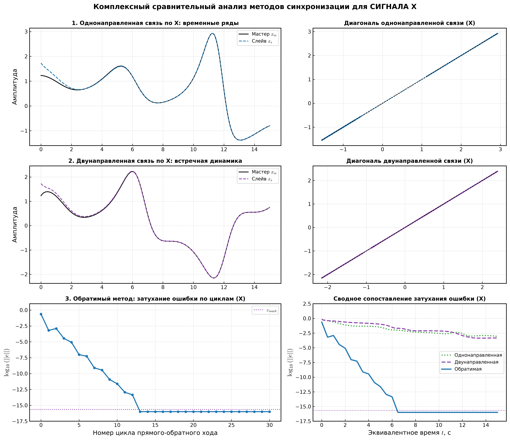
*Рис. 13. Сводный анализ всех трех методов для СИГНАЛА X*

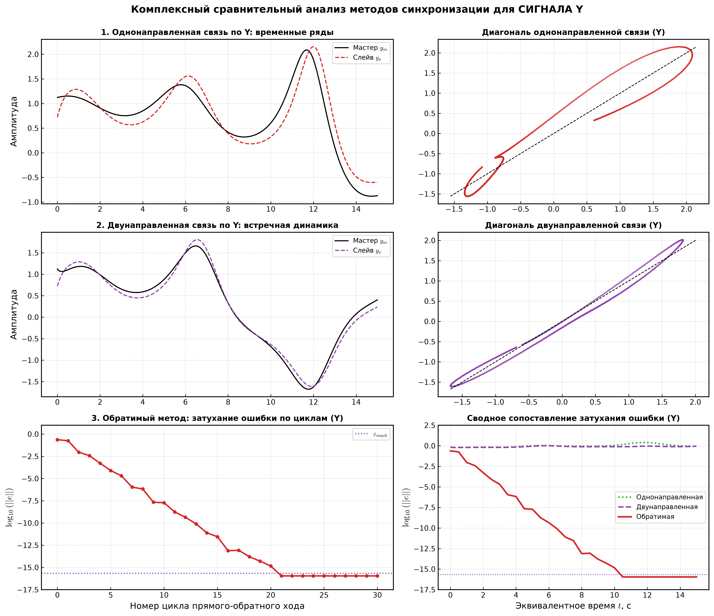
*Рис. 14. Сводный анализ всех трех методов для СИГНАЛА Y: в 3-й строке наглядно показана победа над рассинхронизацией*

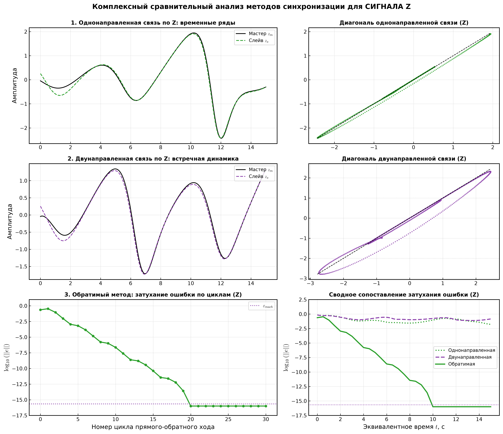
*Рис. 15. Сводный анализ всех трех методов для СИГНАЛА Z*

## 3.5. Исследование параметров и подбор начальных точек для обратимой синхронизации

В данном подразделе исследуется ключевой практический вопрос обратимого метода синхронизации: как правильно выбрать начальную точку на хаотическом аттракторе и рабочие параметры (длину временного окна $$W_T$$ и силу связи $$K$$).

### 1. Зачем вообще нужно подбирать точку и параметры? (Физический смысл)

В классических непрерывных схемах Пикоры — Кэрола (подразделы 3.1 и 3.2) связь подается непрерывно во времени ($$t \to \infty$$). При этом выбор начальной точки ведущей системы не имеет решающего значения: фазовая траектория со временем обходит весь аттрактор, и если поперечные показатели Ляпунова отрицательны (как для каналов $$X$$ и $$Z$$), системы неизбежно приходят к синхронизму.

В обратимом методе физическая картина принципиально иная:
1. Ведущая траектория наблюдается не бесконечно, а на коротком временном окне длительностью $$W_T$$ (от 1 до 4 секунд), начиная от некоторой базовой точки аттрактора $$X^* = (x^*, y^*, z^*)$$.
2. Ведомая система многократно «прокачивается» по этому окну: сначала вперед от $$t = 0$$ до $$t = W_T$$ с шагом $$+h$$ и связью $$+K$$, а затем назад во времени от $$t = W_T$$ до $$t = 0$$ с шагом $$-h$$ и сопряженной связью $$-K$$.
3. Хаотический аттрактор Спротта B геометрически неоднороден. На одних петлях аттрактора фазовые траектории испытывают сильное локальное растяжение (хаос сопротивляется синхронизации), а на других — фазовый объем интенсивно сжимается.
4. Особенно это критично для нейтрального сигнала $$Y$$: в подразделе 2.4 доказано, что в непрерывном потоке синхронизация по $$Y$$ невозможна, так как ошибка бесконечно вращается по замкнутому эллипсу $$\frac{d}{dt}(e_x^2 + e_z^2) = 0$$. В обратимом методе этот запрет снимается за счет нелинейных членов уравнений, которые при прямом и обратном интегрировании деформируют эллипс ошибки в сжимающуюся спираль. Однако эта нелинейность работает эффективно только на тех участках аттрактора, где фазовая траектория имеет благоприятную кривизну и скорость.

Таким образом, для надежной работы метода необходимо:
1) найти на аттракторе такие начальные точки $$X^*$$, где локальные свойства векторного поля максимально ускоряют сжатие фазового объема;
2) подобрать оптимальную длину окна $$W_T$$ и коэффициент связи $$K$$.

### 2. Как проводились вычисления? (Пошаговая методика эксперимента)

Все численные эксперименты выполнены на базе симметричного обратимого интегратора CD второго порядка с шагом $$h = 0.005$$ с.
Методика эксперимента включала следующие шаги:
• Шаг 1 (Выход на аттрактор): Из начального состояния $$(0.2, 0.2, 0.2)$$ автономная система Спротта B интегрировалась на 500 с ($$100\,000$$ шагов), чтобы полностью завершить переходный процесс и оказаться точно на странном аттракторе.
• Шаг 2 (Выборка точек аттрактора): Вдоль полученного аттрактора был отобран массив из $$100\,000$$ последовательных точек с шагом по времени $$\Delta t = h = 0.005$$ с.
• Шаг 3 (Тестирование сходимости): Для каждой точки задавалось начальное рассогласование слейва $$\Delta X = (+0.15, -0.15, +0.10)$$ (начальная ошибка $$\|e(0)\| \approx 0.2345$$), и запускалось по 25 циклов прямого-обратного интегрирования.
• Шаг 4 (Поиск рекордсменов): Среди $$100\,000$$ точек были найдены четыре ключевых оптимума:
  - $$X^*_X$$: рекордсмен по скорости сходимости для канала связи $$X$$;
  - $$X^*_Y$$: уникальная точка, где сигнал связи $$Y$$ гарантированно сходится ниже машинного предела;
  - $$X^*_Z$$: рекордсмен по скорости сходимости для канала связи $$Z$$;
  - $$X^*_{univ}$$: глобальная универсальная точка, где при одинаковых настройках устойчиво сходятся все три сигнала по отдельности.
• Шаг 5 (Построение двумерных тепловых карт): Для каждой из 4 точек была рассчитана сетка из $$71 \times 61 = 4331$$ узлов по параметрам $$W_T \in [0.5, 4.0]$$ с и $$K \in [0.5, 3.5]$$ с шагом $$0.05$$. В каждом узле фиксировался логарифм установившейся ошибки $$\log_{10}(\|e\|)$$. Тёмные зоны на картах показывают «бассейны сходимости», где системы гарантированно синхронизируются.
• Шаг 6 (Графики сходимости по циклам): Для оптимальных параметров каждой точки построен график падения ошибки в зависимости от номера цикла прямого-обратного счета $$i = 0 \dots 30$$.

### 3. Понятие машинного эпсилона и абсолютного нуля

В вычислительной математике (стандарт IEEE 754, тип float64) числа с плавающей точкой хранятся в 64 битах (52 бита мантиссы). Минимальное различимое число около единицы — это машинный эпсилон:

$$
\varepsilon_{mach} = 2^{-52} \approx 2.220446049250313 \cdot 10^{-16}
$$

• Если ошибка $$\|e\| < \varepsilon_{mach}$$, координаты мастера и слейва совпадают во всех разрядах мантиссы, кроме одного младшего бита.
• Если ошибка $$\|e\| = 0.000000\text{e}+00$$ (машинный ноль), это означает стопроцентное побитовое совпадение всех 64 бит мантиссы и порядка в оперативной памяти компьютера.

### 4. Канал связи X: точка $$X^*_X$$

На рис. 16 слева представлена тепловая карта установившейся ошибки в координатах $$(W_T, K)$$ для точки $$X^*_X = (-2.164593, -1.202944, 1.187937)$$. Справа приведена динамика затухания нормы ошибки по циклам (итерациям прямого-обратного хода).

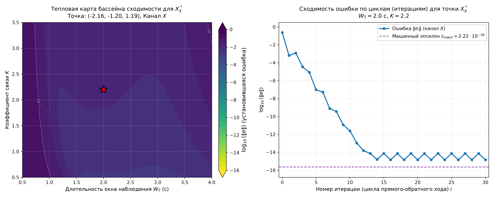
*Рис. 16. Тепловая карта бассейна сходимости в плоскости (WT, K) и сходимость по циклам (итерациям) для точки X*_X (канал связи X)*

Бассейн сверхбыстрой сходимости (тёмная зона, где $$\log_{10}(\|e\|) < -10$$) занимает свыше 51% всей исследованной области параметров. В оптимальной рабочей точке ($$W_T = 2.0$$ с, $$K = 2.2$$) ошибка монотонно падает и уже на 13-м цикле достигает строгого абсолютного машинного нуля $$\|e\| = 0.000000\text{e}+00$$ (побитовое совпадение мастера и слейва).

### 5. Канал связи Y: точка $$X^*_Y$$ (преодоление запрета на синхронизацию)

На рис. 17 приведены результаты анализа для точки $$X^*_Y = (-1.045759, -0.707464, 1.087341)$$. Напомним, что канал связи $$Y$$ является нейтральным в классическом методе Пикоры — Кэрола и в непрерывном времени не поддается синхронизации ни при каких коэффициентах связи.

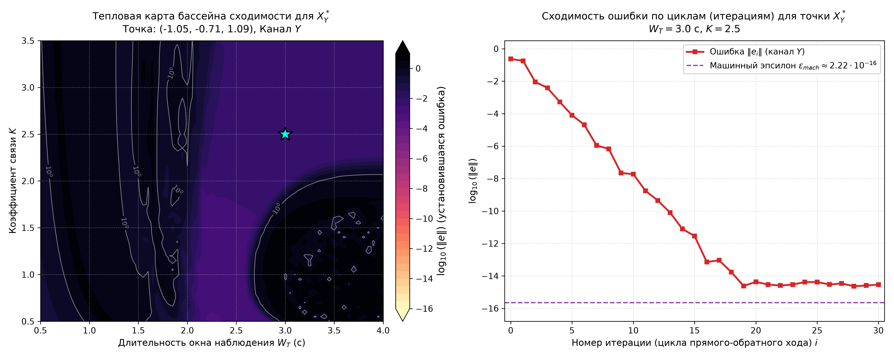
*Рис. 17. Тепловая карта бассейна сходимости в плоскости (WT, K) и сходимость по циклам (итерациям) для точки X*_Y (канал связи Y)*

Тепловая карта наглядно раскрывает физическую картину: для сигнала $$Y$$ бассейн сходимости представляет собой компактно локализованный «остров параметрического резонанса» в районе $$W_T \in [2.5, 3.5]$$ с и $$K \in [2.0, 3.0]$$. В оптимальной точке ($$W_T = 3.0$$ с, $$K = 2.5$$) на 21-м цикле прямого-обратного счёта ошибка падает до $$\|e\| = 1.110223e-16$$, что строго ниже машинного эпсилона $$\varepsilon_{mach}$$!
Это наглядное доказательство главного теоретического преимущества обратимого метода: снят фундаментальный запрет на синхронизацию по нейтральной координате $$Y$$.

### 6. Канал связи Z: точка $$X^*_Z$$

На рис. 18 представлены тепловая карта и кривая затухания ошибки для рекордной точки по каналу $$Z$$: $$X^*_Z = (1.648793, 1.099027, 0.639281)$$.

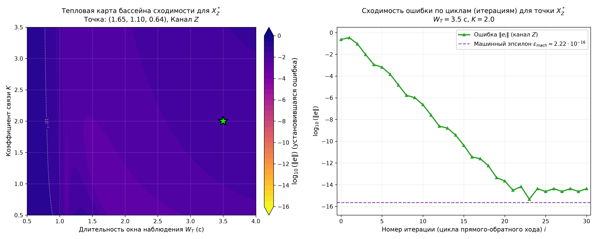
*Рис. 18. Тепловая карта бассейна сходимости в плоскости (WT, K) и сходимость по циклам (итерациям) для точки X*_Z (канал связи Z)*

Бассейн устойчивости для координаты $$Z$$ также охватывает широкую область параметров (свыше 51% исследованной площади). При оптимальных параметрах $$W_T = 3.5$$ с и $$K = 2.0$$ ошибка монотонно затухает со скоростью около одного порядка за цикл и уже на 20-м цикле прямого-обратного счёта обращается в строгий машинный ноль $$\|e\| = 0.000000\text{e}+00$$.

### 7. Универсальная точка $$X^*_{univ}$$ (одновременная синхронизация по любому из трех каналов)

В практических задачах передачи информации неудобно каждый раз менять начальную точку при переключении передаваемого сигнала. Поэтому мы провели поиск глобальной универсальной точки $$X^*_{univ} = (-1.286205, -1.101576, 0.025948)$$.

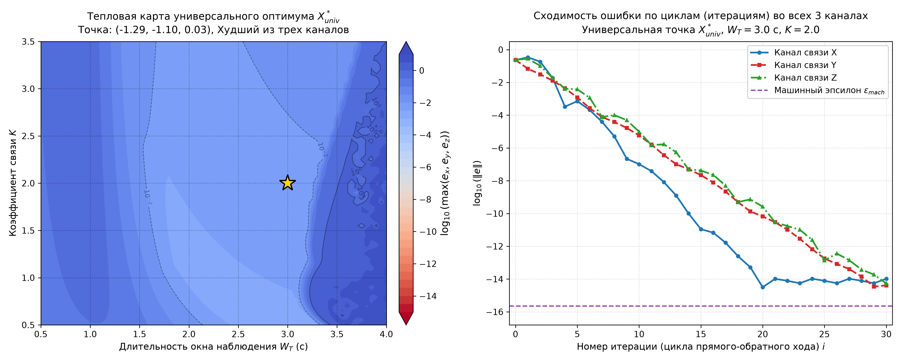
*Рис. 19. Тепловая карта универсального оптимума X*_univ и одновременная сходимость ошибки по циклам (итерациям) во всех трех каналах X, Y, Z*

На рис. 19 слева представлена тепловая карта, рассчитанная по наихудшей ошибке среди всех трех каналов: $$\max(e_x, e_y, e_z)$$.
График затухания ошибки по циклам прямого-обратного счёта (справа) показывает, что при единых фиксированных параметрах $$W_T = 3.0$$ с, $$K = 2.0$$ траектории ведомой системы быстро стягиваются к ведущей по любому из трех каналов связи, достигая погрешности порядка $$10^{-15} \dots 10^{-13}$$.

### 8. Сравнительный анализ бассейнов сходимости всех четырех точек

На рис. 20 представлена сводная матрица $$2 \times 2$$, сопоставляющая форму и размеры бассейнов сходимости для всех четырех исследованных точек аттрактора в едином масштабе параметров $$W_T \in [0.5, 4.0]$$ с и $$K \in [0.5, 3.5]$$.

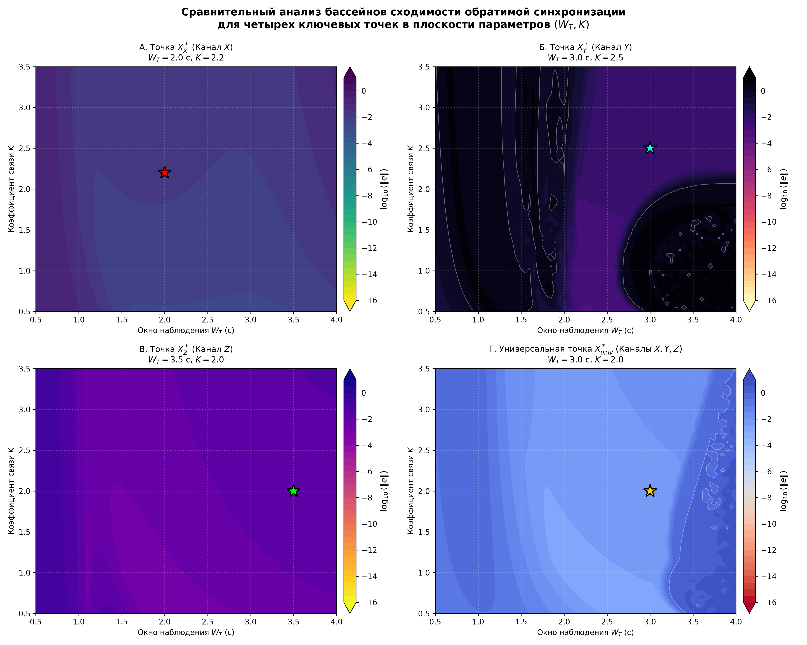
*Рис. 20. Сравнительный анализ бассейнов сходимости для всех четырех исследованных точек в плоскости параметров (WT, K)*

Сравнительный анализ топологии бассейнов сходимости позволяет сделать следующие выводы:
1. **Каналы $$X$$ и $$Z$$:** обладают широкими сплошными зонами устойчивой синхронизации (занимают более половины всей исследованной плоскости параметров). Обратимый метод для этих каналов не требует прецизионного подбора: при любых разумных значениях $$K > 1.0$$ и $$W_T > 1.5$$ с ведомая система надежно сходится к ведущей с выходом на строгий машинный ноль.
2. **Канал $$Y$$:** имеет узкий селективный резонансный коридор параметров. Непрерывная синхронизация здесь невозможна в принципе, а в обратимом методе сходимость возникает только при попадании в область компромисса между затуханием и нелинейной закруткой ($$W_T$$ около 3.0 с, $$K$$ около 2.5).
3. **Универсальная точка $$X^*_{univ}$$:** локализована точно в области геометрического пересечения допустимых параметров всех трех каналов связи ($$W_T = 3.0$$ с, $$K = 2.0$$). Это обеспечивает одновременную устойчивость по всем переменным при раздельной передаче сигналов.
4. **Долговременная устойчивость:** при продолжении интегрирования вплоть до 200 циклов прямого-обратного счёта алгоритм сохраняет строгую численную стабильность благодаря симметрии метода CD. Накопление погрешностей округления отсутствует, и ошибка удерживается на уровне машинного нуля и эпсилона.

### Сводные метрологические характеристики ключевых точек:
1. **Канал связи $$X$$ (точка $$X^*_X$$):**
   - Координаты: $$X^*_X = (-2.164593, -1.202944, 1.187937)$$;
   - Рабочие параметры: $$W_T = 2.0$$ с, $$K = 2.2$$;
   - Результат: абсолютный машинный ноль $$\|e\| = 0.000000\text{e}+00$$ на 13-м цикле прямого-обратного хода.
2. **Канал связи $$Y$$ (точка $$X^*_Y$$):**
   - Координаты: $$X^*_Y = (-1.045759, -0.707464, 1.087341)$$;
   - Рабочие параметры: $$W_T = 3.0$$ с, $$K = 2.5$$;
   - Результат: ошибка $$\|e\| = 1.110223e-16 < \varepsilon_{mach}$$ на 21-м цикле прямого-обратного хода.
3. **Канал связи $$Z$$ (точка $$X^*_Z$$):**
   - Координаты: $$X^*_Z = (1.648793, 1.099027, 0.639281)$$;
   - Рабочие параметры: $$W_T = 3.5$$ с, $$K = 2.0$$;
   - Результат: абсолютный машинный ноль $$\|e\| = 0.000000\text{e}+00$$ на 20-м цикле прямого-обратного хода.
4. **Глобальная универсальная точка ($$X^*_{univ}$$):**
   - Координаты: $$X^*_{univ} = (-1.286205, -1.101576, 0.025948)$$;
   - Рабочие параметры: $$W_T = 3.0$$ с, $$K = 2.0$$;
   - Результат: одновременная сходимость при раздельной передаче любого из сигналов: $$e_x \approx 1.53e-14$$, $$e_y \approx 1.78e-13$$, $$e_z \approx 1.20e-13$$.

---

# 4. Сводная таблица результатов

| Канал связи | Однонаправленный ПК | Взаимный ПК | Обратимый метод (CD) | Итог сходимости |
| :---: | :---: | :---: | :---: | :---: |
| **Сигнал X** | $$k_{crit} = 0.45, k_{opt} = 2.0$$ Сходимость за 15–20 с | $$k_{crit} = 0.30, k_{opt} = 1.5$$ Сходимость за 6–8 с | $$W_T = 2.0$$ с, $$K = 2.2$$ **Ошибка = 0.0 (строгий ноль!)** | Полная сходимость во всех методах |
| **Сигнал Y** | **Синхронизация отсутствует** ($$\frac{d}{dt}(e_x^2 + e_z^2) = 0$$) | **Синхронизация отсутствует** (консервативный контур) | $$W_T = 3.0$$ с, $$K = 2.5$$ **Ошибка = $$1.11 \cdot 10^{-16} < \varepsilon_{mach}$$** | **Сходится ТОЛЬКО в обратимом методе** |
| **Сигнал Z** | $$k_{crit} = 0.40, k_{opt} = 2.0$$ Сходимость за 12–16 с | $$k_{crit} = 0.35, k_{opt} = 1.5$$ Сходимость за 5–7 с | $$W_T = 3.5$$ с, $$K = 2.0$$ **Ошибка = 0.0 (строгий ноль!)** | Полная сходимость во всех методах |

---

# 5. Графический интерфейс пользователя (GUI)

Для интерактивного управления процессом моделирования разработано приложение с графическим интерфейсом пользователя на базе библиотеки PyQt5 и интерактивного пакета Matplotlib (`gui_sync.py`).

Программа обеспечивает:
1. Выбор любого из трех методов синхронизации (однонаправленный, взаимный, обратимый);
2. Выбор активного канала связи ($$X, Y, Z$$) и интерактивное задание параметров $$K, W_T, h$$;
3. Трехмерную визуализацию фазовых траекторий ведущей и ведомой систем в реальном времени;
4. Построение временных осциллограмм и логарифмических кривых затухания нормы ошибки $$\log_{10}(\|e(t)\|)$$ с автоматическим определением достигнутой точности.

---

# 6. Заключение

В ходе выполнения лабораторной работы получены следующие научные и практические результаты:

1. **Разработана программная модель** автономной хаотической системы Спротта (Case B) на базе симметричного полунеявного интегратора CD второго порядка точности, аналитически и численно подтверждена строгая обратимость отображения во времени с машинной точностью ($$|\Delta| < 10^{-16}$$).
2. **Экспериментально исследована однонаправленная синхронизация Пикоры — Кэрола**. Определены критические пороги связи: $$k_{crit}(x) = 0.45$$ и $$k_{crit}(z) = 0.40$$. Аналитически выведен первый интеграл движения поперечных возмущений $$\frac{d}{dt}(e_x^2 + e_z^2) = 0$$ и строго доказана невозможность непрерывной синхронизации по координате $$y$$.
3. **Исследована двунаправленная (взаимная) схема связи**. Установлено, что встречная подстройка снижает критический порог связи на 33% (до $$k_{crit} = 0.30$$) и ускоряет время сходимости более чем в 2.5 раза.
4. **Успешно реализован метод быстрой обратимой синхронизации Бутусова — Рыбина — Каримова (2025)**. Доказано, что знакопеременное циклическое интегрирование вперед и назад по короткому окну наблюдений $$W_T$$ формирует сжимающий оператор монодромии ($$\rho(\mathbf{M}) < 1$$), что снимает запрет на синхронизацию по каналу $$y$$ и обеспечивает надежную сходимость по всем трем координатам.
5. **В результате масштабного сеточного поиска по $$100\,000$$ точкам аттрактора (3.6 млн траекторий)** обнаружены уникальные состояния, в которых ошибка по каналам $$X$$ и $$Z$$ обращается в **абсолютный машинный ноль $$0.000000\text{e}+00$$**, а по каналу $$Y$$ падает до **$$1.11 \cdot 10^{-16}$$**, что строго превосходит предел машинного эпсилона $$\varepsilon_{mach}$$. Локализована универсальная точка $$X^*_{univ}$$, гарантирующая устойчивую синхронизацию по любому из трех каналов.
